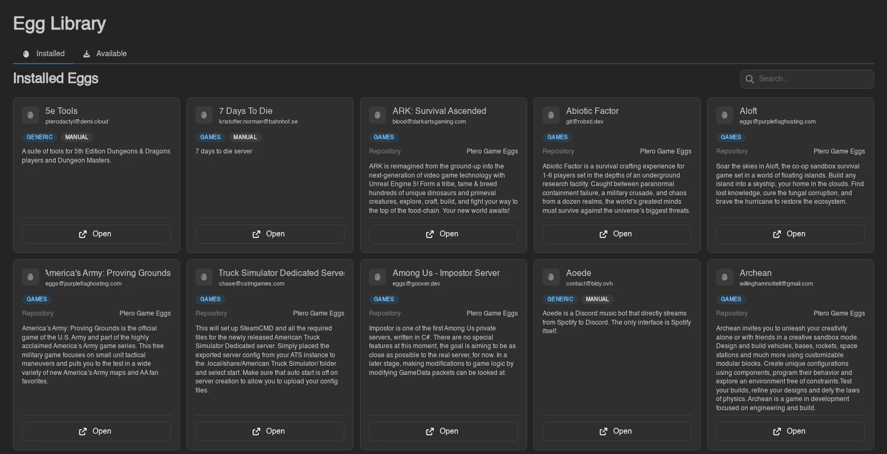
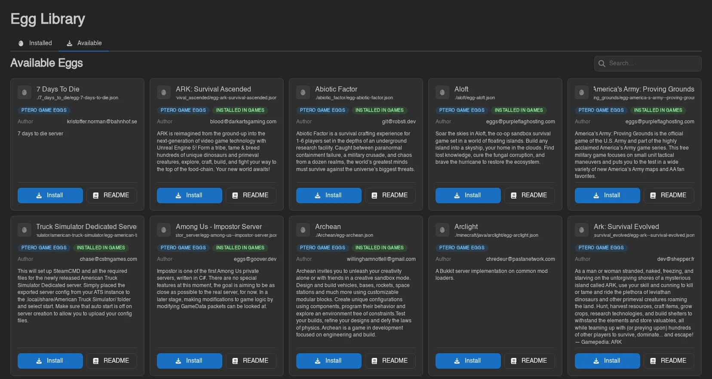
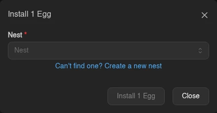

# Egg Library

The Egg Library (**Nests & Eggs** > **Egg Library**, `/admin/egg-library`) gathers eggs from every nest and every [egg repository](./egg-repositories.md) on one page. You can see what's installed, find the eggs that have a newer version in their repository, and install new ones without opening each repository first. It has two tabs, **Installed** and **Available**, and both show eggs as cards with a search box and pagination.

The page needs `eggs.read`. The **Available** tab also needs `egg-repositories.read`.

## Installed

Every egg on the panel, whichever nest it's in, sorted by name. The search matches egg names.

Each card shows the egg's name, author, and description, plus these badges:

| Badge | Meaning |
|---|---|
| Nest name (blue) | The nest the egg lives in. |
| **Update Available** (yellow) | The egg was installed or last updated from a repository, and the repository's copy has changed since. |
| **Manual** (gray) | The egg isn't linked to a repository egg, for example because it was created by hand or imported from a file or URL. |

Linked eggs also show the **Repository** they come from. **Open** goes to the egg in its nest. **Update** appears only when an update is available and you have `eggs.update`. It re-imports the egg from its repository, the same as **Update** > **from Repository** on the [egg itself](./nests.md#general), and confirms with "Paper updated from its repository." or similar.

The panel only knows an update is waiting if it recorded which repository version an egg has. That happens when the egg is installed from a repository or updated with **from Repository**. Eggs installed before the Egg Library existed, and eggs last overwritten from a file or URL, never show **Update Available**. Run **from Repository** on them once and they're tracked from then on. Repository changes only show up after the repository has been synced, which happens daily when [Automatic Sync](./egg-repositories.md#syncing) is on.

Updating an egg changes its template, not servers that already use it. See [Updating Eggs](../../next-steps/egg-repos.md#updating-eggs) for what that means for existing servers.

## Available

Every egg found by the last sync of every egg repository, sorted by name and then by path. The search matches egg names and file paths inside the repositories.

Each card shows the egg's [banner](./egg-repositories.md#banners) if the repository has one for it, then its name, its path in the repository, the repository as a blue badge, the author, and the description. For each nest the egg is already installed in, an **Installed in** badge names the nest. It turns yellow when the panel knows the repository version is newer than that copy, and is green otherwise.

- **Install** (needs `eggs.create` and `nests.read`) opens the install dialog with the repository's **Default Nest** preselected. Pick another nest or create one with **Can't find one? Create a new nest**. If the nest already has an egg with that name, the install is skipped instead of creating a duplicate. There is no error for this; the toast just reads "0 Eggs installed."
- **README** opens the egg's README drawer, with the banner on top and its own **Install** button. Eggs without a README show "This egg does not have a README."

With no repositories, or none synced yet, the tab shows "No eggs available" and a **Go to Egg Repositories** button. A newly created repository syncs on its own, so its eggs appear here shortly after you save it.

## Other Places to Install From

The same repository search also appears in two other places:

- **Import** > **from Repository** on a nest's [Eggs tab](./nests.md#importing-eggs) installs straight into that nest.
- **Can't find it? Install one from a repository** under the egg picker when [creating a server](./servers.md#server-assignment) installs an egg and selects it for the new server.

::: info
Actions here map to the `eggs.*`, `nests.read`, and `egg-repositories.read` admin permissions; see the [Permissions Reference](../dashboard/permissions.md).
:::
