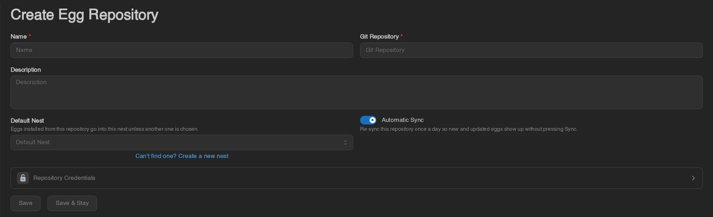
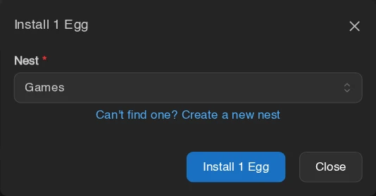

# Egg Repositories

Egg repositories are Git repositories that store collections of eggs - the configuration files that tell the panel how to install and run a specific game server type. Calagopus has a built-in egg repository system that lets you browse and import eggs directly from the admin UI, similar to what Blueprint's Eggify extension provided for Pterodactyl.

Calagopus has backwards compatibility for Pterodactyl eggs, so you can use the official Pterodactyl egg repositories as a starting point:
- [pterodactyl/game-eggs](https://github.com/pterodactyl/game-eggs)
- [pterodactyl/application-eggs](https://github.com/pterodactyl/application-eggs)
- [pterodactyl/generic-eggs](https://github.com/pterodactyl/generic-eggs)

::: info
You can also add egg repositories directly from the OOBE when first setting up Calagopus - select the repositories you want and click Import. Each one gets its own nest (**Games**, **Applications**, or **Generic**, reusing a nest of that name if it already exists) as its default nest, with automatic sync on. The setup wizard's server step then installs your chosen egg into that nest, and only asks for a nest name when the repository has no default nest.

:::

## How Egg Repositories Work

An egg repository is a Git repository organized into directories, with each egg defined as a JSON file following the Pterodactyl/Calagopus egg format. Repositories commonly separate games, applications, and programming languages into separate repositories or subdirectories.

## Adding a Repository

Head to **Admin → Egg Repositories** and click **Create**.

Fill in the fields:
- **Name**: A label to distinguish this repository from others.
- **Git Repository**: The full URL of the Git repository (e.g. `https://github.com/pterodactyl/game-eggs`).
- **Description**: Optional description.
- **Default Nest**: Optional. The nest eggs from this repository are installed into unless you pick another one. **Can't find one? Create a new nest** creates one on the spot.
- **Automatic Sync**: On by default. Re-syncs the repository once a day so new and updated eggs show up on their own.

Click **Save**. The panel starts syncing the repository in the background right away. To sync again later, for example after pushing a change to your own repository, open it and click **Sync**.

Syncing doesn't install any eggs - it populates the repository's Eggs tab and the [Egg Library](../features/admin/egg-library.md) with the full list from the repository so you can choose which ones to import.

## Importing Eggs

The quickest way is the **Available** tab of **Admin → Egg Library**. It shows the eggs of all your repositories as cards. Search for the egg, click **Install**, confirm the nest (the repository's default nest is preselected), and click **Install** again. **README** shows the egg's documentation first if you want it.

You can also install eggs while creating a server (**Can't find it? Install one from a repository** under the egg dropdown) or from a nest's **Import** > **from Repository** menu.

To install several eggs at once, use the repository itself. Head to the **Eggs** tab for the repository. You'll see a list of all available eggs.

For documentation on what a specific egg does, check the same path in the source Git repository.

Select the eggs you want by dragging them into the selection area or searching by name, then click **Install**.

A popup will ask which nest to import into, preselecting the repository's default nest if it has one. A nest is a category for eggs, such as Minecraft. If you don't have one yet, click **Can't find one? Create a new nest** in the popup, or [create a nest](../features/admin/nests.md#creating-and-editing-a-nest) under **Admin → Nests**. Select the nest and click **Install**. Eggs whose name already exists in that nest are skipped. This imports the template; it does not create or start a game server.

## Updating Eggs

When an egg in the repository has been updated, the repository needs to be synced before the panel notices. Repositories with **Automatic Sync** do that once a day; otherwise, or if you don't want to wait, sync it by hand. Then update the egg in the panel.

The **Installed** tab of **Admin → Egg Library** marks eggs whose repository version has changed with **Update Available** and gives them an **Update** button. This only works for eggs that were installed or last updated from a repository: eggs from before the Egg Library existed, or last overwritten from a file, need one manual **Update from Repository** first (below) before they're tracked.

### Updating a Single Egg

Re-sync the repository:

Then head to **Admin → Nests**, click the nest containing the egg, click the egg, scroll down to the **Update** section, and click **Update from Repository**.

### Updating Multiple Eggs at Once

Re-sync the repository, then head to **Admin → Nests** and open the nest. Select the eggs you want to update and click **Update from Repository** in the action bar.

Updating an egg changes its template, not the game files already installed on your servers. Depending on what changed, you may need to update a server's settings, choose a different runtime image, or rerun its installer. Before reinstalling, back up the server and read the [reinstall warning](../features/server/settings.md#reinstall-server): the install script can modify or delete files even when you don't choose to wipe the server first.
